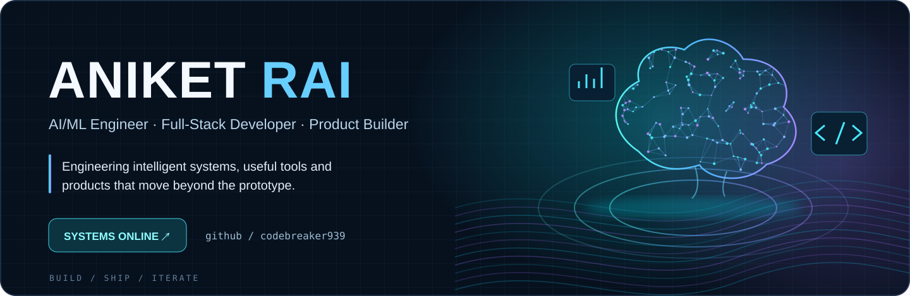
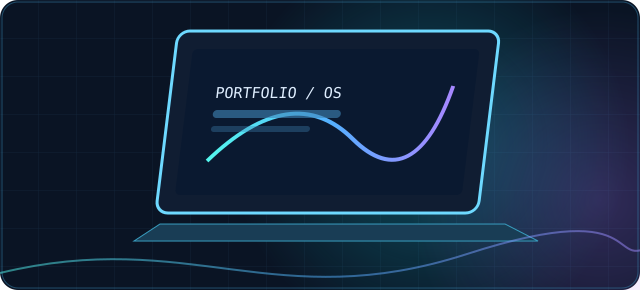
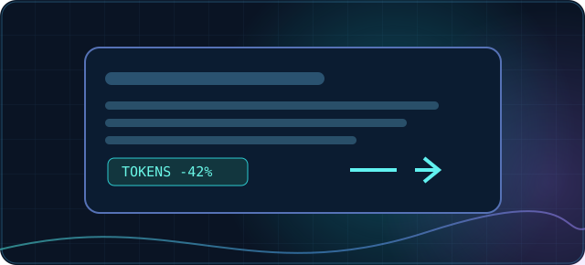
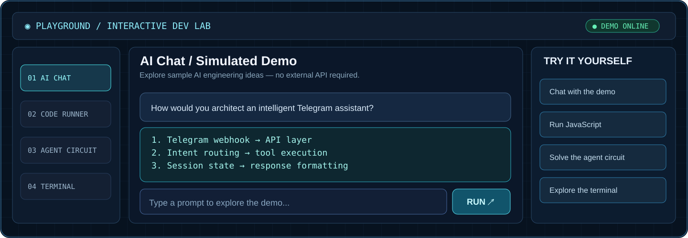

<!--
  ANIKET RAI · GITHUB PROFILE README
  Website URL becomes active after you enable GitHub Pages for main /docs.
  Telegram News Bot repository verified at github.com/codebreaker939/TELEGRAM_NEWS_BOT.
-->

<div align="center">
  <a href="https://codebreaker939.github.io/codebreaker939/">
    
  </a>

  <br />

  <a href="https://codebreaker939.github.io/codebreaker939/"><strong>▶ LAUNCH INTERACTIVE PLAYGROUND</strong></a>
  &nbsp;&nbsp;·&nbsp;&nbsp;
  <a href="https://aniket-s-os.vercel.app/"><strong>PORTFOLIO ↗</strong></a>
  &nbsp;&nbsp;·&nbsp;&nbsp;
  <a href="https://github.com/codebreaker939?tab=repositories"><strong>REPOSITORIES ↗</strong></a>
  &nbsp;&nbsp;·&nbsp;&nbsp;
  <a href="mailto:raianiket@outlook.com"><strong>CONTACT ↗</strong></a>
</div>

<br />

### `01 // Selected work`

<table>
  <tr>
    <td width="50%" valign="top">
      <a href="https://aniket-s-os.vercel.app/"></a>
      <br />
      <strong>Portfolio OS</strong> · <code>Live</code>
      <br />
      A personal space for engineering work, experiments, and shipped projects.
      <br /><br />
      <a href="https://aniket-s-os.vercel.app/">Explore the website →</a>
    </td>
    <td width="50%" valign="top">
      <a href="https://github.com/codebreaker939/TELEGRAM_NEWS_BOT"></a>
      <br />
      <strong>Telegram News Bot</strong> · <code>MCP + Automation</code>
      <br />
      MCP-powered news ingestion and a Telegram agent with digest delivery and grounded conversations.
      <br /><br />
      <a href="https://github.com/codebreaker939/TELEGRAM_NEWS_BOT">View Telegram News Bot →</a>
    </td>
  </tr>
  <tr>
    <td width="50%" valign="top">
      <a href="https://github.com/codebreaker939/Prompt-Compressor-"></a>
      <br />
      <strong>Prompt Compressor</strong> · <code>AI tooling</code>
      <br />
      Chrome extension work exploring LLM-based prompt compression and API integration.
      <br /><br />
      <a href="https://github.com/codebreaker939/Prompt-Compressor-">View repository →</a>
    </td>
    <td width="50%" valign="top">
      <a href="mailto:raianiket@outlook.com?subject=BYT%20Solutions"></a>
      <br />
      <strong>BYT Solutions</strong> · <code>In development</code>
      <br />
      Building an IT solutions ecosystem across software services and original products.
      <br /><br />
      <a href="mailto:raianiket@outlook.com?subject=BYT%20Solutions">Learn more →</a>
    </td>
  </tr>
</table>

<br />

### `02 // Interactive playground`

The GitHub README is the entry point. The full experience is a **working browser-based developer playground**, with four interactive modules:

- **AI Chat Demo** — explore prepared architecture walkthroughs. Clearly labelled simulated; no external AI API.
- **JavaScript Runner** — edit and execute JavaScript inside an isolated browser sandbox.
- **Agent Circuit** — a playable AI workflow puzzle.
- **Developer Terminal** — explore my projects and skills using commands like `help`, `projects`, and `stack`.

<a href="https://codebreaker939.github.io/codebreaker939/">
  
</a>

<p align="center"><a href="https://codebreaker939.github.io/codebreaker939/"><strong>▶ ENTER THE DEVELOPER LAB ↗</strong></a></p>

<sub>Note: The link goes live after this repository's GitHub Pages site is enabled from the <code>/docs</code> directory.</sub>

<br />

### `03 // Engineering toolkit`

| Area | Technologies |
| :-- | :-- |
| **AI / ML** | Python · ML foundations · LLM integrations · FastAPI |
| **Frontend** | React · JavaScript · HTML · CSS · MERN |
| **Backend** | Node.js · Express · REST APIs · Python |
| **Data & tooling** | MongoDB · SQL · Git · GitHub · Postman |
| **Currently exploring** | Spring AI · Agentic AI · Cloud architecture · System design |

<br />

### `04 // More about me`

I'm a Computer Science undergraduate with an interest in building intelligent systems, useful developer tools, and end-to-end products. I like working at the intersection of **engineering, problem solving, and product thinking**.

<details>
  <summary><strong>Try the terminal commands</strong></summary>
  <br />
  Open the <a href="https://codebreaker939.github.io/codebreaker939/">playground</a>, select <strong>Terminal</strong>, and try:

  ```sh
  whoami
  projects
  stack
  contact
  help
  ```
</details>

<br />

---

<p align="center">
  <a href="https://www.linkedin.com/in/aniketrai07/">LinkedIn</a>
  &nbsp;·&nbsp;
  <a href="https://github.com/codebreaker939">GitHub</a>
  &nbsp;·&nbsp;
  <a href="https://aniket-s-os.vercel.app/">Portfolio</a>
  &nbsp;·&nbsp;
  <a href="mailto:raianiket@outlook.com">Email</a>
</p>

<p align="center"><sub>Build / Ship / Iterate · Aniket Rai</sub></p>
